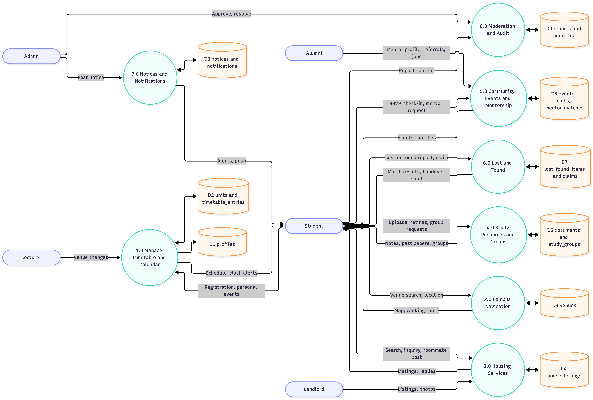
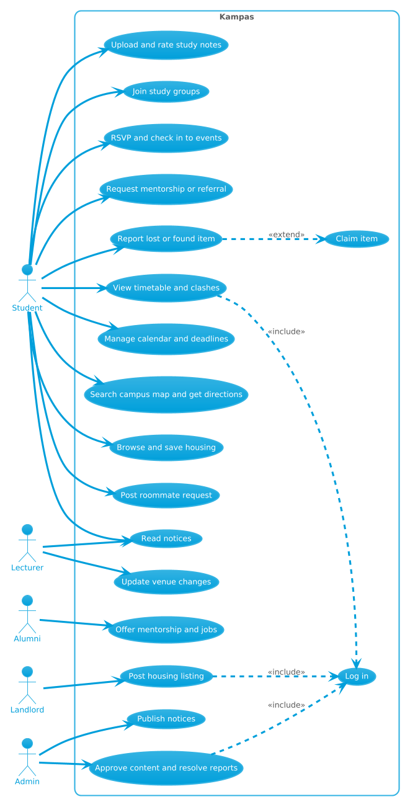
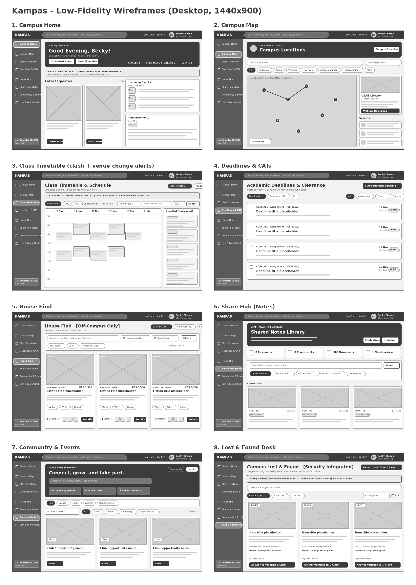

<div align="center">

# 🎓 Kampas

### The campus, in one place.

A responsive, offline-first student platform and Progressive Web App (PWA) for the **University of Eastern Africa, Baraton (UEAB)**, Nandi County, Kenya.


[🎥 Demo video](https://youtu.be/oVPTXHhnves) · [🌐 Live app](#screenshots--demo) · [📐 System design](#system-design) · [🚀 Run it](#how-to-run-the-project) · [📄 Business model](docs/Business_Model.pdf)

</div>

---

## Table of Contents

1. [Project Title and Team](#project-title-and-team)
2. [Problem Statement and Research](#problem-statement-and-research)
3. [Proposed Solution](#proposed-solution)
4. [System Design](#system-design)
5. [Technology Stack](#technology-stack)
6. [Screenshots / Demo](#screenshots--demo)
7. [How to Run the Project](#how-to-run-the-project)
8. [Business Model Summary](#business-model-summary)
9. [Testing and User Feedback](#testing-and-user-feedback)
10. [Contributions](#contributions)
11. [Future Improvements and Conclusion](#future-improvements-and-conclusion)
12. [Honest Status: What Is Real and What Is Simulated](#honest-status-what-is-real-and-what-is-simulated)
13. [Credits and Licence](#credits-and-licence)

---

## Project Title and Team

| | |
| --- | --- |
| **Project** | Kampas: The campus, in one place |
| **Hackathon** | ISC Digital Build-Off Hackathon 2026, Department of Information Systems and Computing, UEAB |
| **Theme** | Campus Problems |
| **Team name** | TheAonix |
| **Team leader** | Becky Cherop ⭐ |
| **Repository** | https://github.com/cheropbecky/ISC-Digital-BUild-Off-2026--TheAonix |

| Name | Registration No. | Role | Team Leader |
| --- | --- | --- | :---: |
| Becky Cherop | SKIPCH2511 | Frontend Developer and UI Specialist | ⭐ |
| Jacob Sihul | SSIHOT2511 | Backend and API Developer | |
| Nathan Kimutai | SKIMNA2511 | Database Engineer | |
| Thabita Jeptoo | STHAJE2511 | DevOps and QA Specialist | |

---

## Problem Statement and Research

### The problem

Student life at UEAB is split across physical notice boards, WhatsApp groups, PDF memos and word of mouth. Six problems come up again and again:

| # | Problem | Consequence |
| --- | --- | --- |
| 1 | **Timetables and venues** change at short notice and are announced in scattered places | Missed lectures, CATs and exam clashes |
| 2 | **Navigation** across the large, rural Baraton campus has no digital map or indoor signage | New students get lost finding halls, labs and offices |
| 3 | **Off-campus housing** around Baraton Centre, Chemamul, Kaimosi Road, Koitalel and Cheterit is found through brokers who charge fees for unverified listings | Fees, fraud risk, rooms without reliable water or security |
| 4 | **Study resources** (past papers, notes) sit in personal drives and printouts | Unequal access to revision material |
| 5 | **Lost items, unclear notices and weak mentorship links** | Items never recovered, missed notices, few alumni connections |
| 6 | **Weak campus bandwidth** makes heavy web portals fail at peak hours | Students cannot rely on online tools |

### Who it affects

Students (especially freshmen and off-campus residents), lecturers, class representatives, club officers, alumni, employers and university staff. Landlords are affected too, as the people students rent from.

### Interview summary

> ⚠️ **TODO (required by the hackathon guide: at least 3 real users).** Replace this block with your real findings before submitting.

| # | Interviewee (role) | How they cope today | What they would value |
| --- | --- | --- | --- |
| 1 | TODO | TODO | TODO |
| 2 | TODO | TODO | TODO |
| 3 | TODO | TODO | TODO |

---

## Proposed Solution

Kampas puts navigation, planning, housing, study, community and lost-and-found into one installable app that keeps working on weak data.

### Key features

| Module | Route | What a user can do |
| --- | --- | --- |
| **Campus Home** | `/home` | Live countdown to the next lecture, one-tap "Navigate to Venue", urgent deadlines and CATs, housing and event highlights |
| **Timetable and Calendar** | `/campus/timetable` | Week, day and list views (07:00 to 19:00); automatic **clash detection**; **venue-changed badges**; class detail drawer with lecturer, building floor, projector and power info; **ICS export**; **share as PNG**; **in-browser OCR scan** of a paper timetable (Tesseract.js, nothing leaves the device) |
| **Campus Map** | `/campus/map` | 33 mapped UEAB locations (32 with verified GPS) with category filters, clustering, satellite / OpenStreetMap / aerial layers, door photos, and **pedestrian walking directions** with distance and time |
| **Venues and Units** | `/campus/venues/:id`, `/campus/units/:code` | Venue amenities, capacity and accessibility; unit syllabus, credits and lecturer |
| **Deadlines and CATs** | `/campus/deadlines` | Track, add and complete assignments, labs, exams and clearances with urgency colouring |
| **House Find** | `/housing`, `/housing/:id` | 13 off-campus listings; filter by area, type, rent, distance, furnished, 24/7 borehole water and Wi-Fi; list or map view; **compare up to 3 rentals**; save listings; call or message landlords; roommate board; anti-fraud advisory |
| **Share Hub** | `/share`, `/share/upload`, `/share/groups` | Browse, preview, rate and bookmark notes and past papers; upload notes that a Class Rep or Lecturer must approve; create and join study groups |
| **Community and Events** | `/community/*` | Events with RSVP and QR check-in token; clubs; alumni directory with a **3-step referral pitch**; internships and attachments |
| **Lost and Found** | `/found` | Camera-first reporting, handover points, private verification question, **automatic match suggestions** with confidence, claim flow |
| **Notifications** | `/notifications` | Normal / Important / Urgent alerts and official notices that need acknowledgement |
| **Profile** | `/profile` | Digital student ID card, privacy toggles, dark mode and **text-only low-data mode** |
| **Global Search** | `/search` | One search across venues, housing, units, documents, events, clubs, alumni and lost items |
| **Feedback** | `/feedback` | Bug, feature, UI and general feedback with rating and anonymous option |

### Built for UEAB

- **Sabbath-aware timetable:** Friday evening vespers and Saturday services appear in the schedule.
- **Real campus data:** 33 actual UEAB facilities and a 21-point campus boundary polygon.
- **Pedestrian routing:** walking routes, not vehicle detours.
- **Low-data design:** PWA install, cached static assets, local persistence and a text-only mode.

### User roles

| Role | Highlights |
| --- | --- |
| Student | All core modules |
| Lecturer | Issue venue changes, approve documents, verify lost-item claims, post notices |
| Class Representative | Approve study documents for their class |
| Club Officer | Create and manage club events |
| Alumnus | Referral inbox, accept or decline referral pitches, mentor |
| Employer | Post internships, attachments and trainee openings |
| Staff Member | Issue clearance notices, verify claims |
| Super Admin | Full control, audit logs, approvals |

> Landlords are **not** a login role. They appear as contact details on listings.

---

## System Design

| Diagram | File |
| --- | --- |
| ERD | [database/erd.png](database/erd.png) |
| EER | [docs/eer.png](docs/eer.png) |
| Data Flow Diagrams (DFD) | [docs/dfd.png](docs/dfd.png) |
| Use case diagram | [docs/use-case.png](docs/use-case.png) |
| Wireframes | [docs/wireframes.png](docs/wireframes.png) |

### ERD


### EER


### Data Flow Diagrams



### Use case diagram



### Wireframes



### Architecture

```text
Browser (React 19 PWA, HashRouter)
 ├─ Global store (React Context + localStorage)   ← demo mode: all data lives here
 ├─ Leaflet map ── Esri / OpenStreetMap tiles
 │              └─ FOSSGIS OSRM (pedestrian routing)
 ├─ Tesseract.js (client-side timetable OCR)
 ├─ Service worker (vite-plugin-pwa, precached assets)
 └─ Optional, when keys are set:
      ├─ Supabase (PostgreSQL + Row Level Security)
      └─ Clerk (authentication)
```

### Data model

Main tables in [`database/schema.sql`](database/schema.sql): `profiles`, `units`, `registrations`, `venues`, `timetable_entries`, `deadlines`, `user_deadlines`, `documents`, `study_groups`, `clubs`, `events`, `alumni_profiles`, `referral_requests`, `lost_found_items`, `notices`, `push_subscriptions`.
Row Level Security rules are in `database/policies.sql` and sample data in `database/seed.sql`.
House listings and roommate posts are currently client-side data (`src/data/houses.ts`).

### Project structure

```text
.
├── src/
│   ├── app/          # Router and layouts
│   ├── components/   # map/, shared/ (sidebar, tab bar, role switcher), ui/
│   ├── config/       # Feature flags
│   ├── data/         # venues, timetable, units, deadlines, events, houses
│   ├── features/     # core/, navigate/, housing/, share/, community/, found/
│   ├── lib/          # store, types, permissions, supabase client, OCR
│   ├── services/     # timetable and search services
│   └── styles/       # design tokens and role definitions
├── public/           # brand assets, PWA icons, sample study documents
├── database/         # schema.sql, policies.sql, seed.sql, ERD
├── docs/             # Business_Model.pdf, Pitch_Slides.pdf, diagrams, research notes
├── screenshots/      # images used in this README
├── .env.example
└── LICENSE
```

---

## Technology Stack

| Layer | Tools |
| --- | --- |
| **Languages** | TypeScript, SQL, CSS |
| **Frontend** | React 19, Vite 8, React Router 7 (HashRouter), Tailwind CSS v4, Motion, Lucide |
| **Maps** | Leaflet, React Leaflet, Leaflet.markercluster, Esri World Imagery, OpenStreetMap, FOSSGIS OSRM (foot profile) |
| **On-device AI** | Tesseract.js (timetable OCR in the browser) |
| **Database** | Supabase PostgreSQL schema with Row Level Security (activates when keys are set) |
| **Authentication** | Local demo auth by default; Clerk SDK installed for production |
| **Validation** | Zod |
| **PWA** | vite-plugin-pwa (autoUpdate service worker, installable manifest) |
| **Hosting and tools** | Vercel, GitHub, Google AI Studio, Claude |

---

## Screenshots / Demo

🎥 **Demo video:** https://youtu.be/oVPTXHhnves

[](https://youtu.be/oVPTXHhnves)

🌐 **Live app:** TODO: add your Vercel URL

| Home | Timetable | Campus Map |
| :---: | :---: | :---: |
|  |  |  |
| **House Find** | **Share Hub** | **Lost and Found** |
|  |  |  |

> Add these six images to `screenshots/` (see the checklist at the end of this file).

---

## How to Run the Project

**Requirements:** Node.js 18 or newer and npm.

```bash
# 1. Clone
git clone https://github.com/cheropbecky/ISC-Digital-BUild-Off-2026--TheAonix.git
cd ISC-Digital-BUild-Off-2026--TheAonix

# 2. Install
npm install

# 3. Environment (optional: the app runs in demo mode without keys)
cp .env.example .env

# 4. Start the dev server
npm run dev
```

Open **http://localhost:3000**. Routes use hashes, for example `http://localhost:3000/#/home`.

> If the final code is not on `main` yet, run `git checkout Becky` after cloning.

### Try the demo

1. Click **Enter Kampas**, then **Create Account** and use any student ID, for example `S21/04589`, with any password.
2. Finish the 3-step onboarding (course and year, interests, notification preferences).
3. Use the **role switcher** at the top to act as a Student, Class Rep or Alumnus and run the scripted demo flows (document approval, alumni referral, lost-and-found match).

### Production build

```bash
npm run lint      # TypeScript check
npm run build     # build with PWA service worker
npm run preview   # preview the build
```

### Environment variables

| Variable | Required | Purpose |
| --- | :---: | --- |
| `VITE_CLERK_PUBLISHABLE_KEY` | No | Clerk authentication |
| `VITE_SUPABASE_URL` | No | Supabase project URL |
| `VITE_SUPABASE_ANON_KEY` | No | Supabase anonymous key |
| `VITE_DEV_ROLE_SWITCHER` | No | Set to `false` to hide the role switcher in production |
| `VITE_DEV_TOOLS` | No | Enables the map coordinate picker |

> Never commit real keys. Only `.env.example` belongs in the repository.

### Connect Supabase (optional)

1. Create a Supabase project.
2. Run `database/schema.sql`, then `database/policies.sql`, then `database/seed.sql` in the SQL editor.
3. Put the project URL and anon key in `.env`.

### Install as an app

Android Chrome: menu, **Install app**. iPhone Safari: **Share**, **Add to Home Screen**. Desktop Chrome or Edge: install icon in the address bar.

---

## Business Model Summary

📄 **One-page business model:** [docs/Business_Model.pdf](docs/Business_Model.pdf)

| | |
| --- | --- |
| **Who uses it** | UEAB students (free for students) |
| **Who pays** | The university (campus licence), landlords (verified listing), employers and alumni (promoted opportunities) |
| **Revenue model** | Campus licence; verified listing fee; employer and alumni opportunity posts. All are proposed and still to be validated |
| **Costs** | Free tiers during the pilot (Vercel, Supabase, Clerk); paid tiers as usage grows; no payment processing, so no FinTech licensing |
| **First 100 users** | Class representatives, clubs and societies, orientation week demos, QR posters, the Student Guild housing liaison |
| **Risks** | Data privacy under the Kenya Data Protection Act, 2019; production-grade authentication; moderation of user content; reliance on public routing servers |

---

## Testing and User Feedback

Kampas was tested with two UEAB student groups.

| Feedback | What we changed |
| --- | --- |
| Finding off-campus housing took too many steps on mobile | Added quick filter pills for water, Wi-Fi and distance, plus direct landlord call buttons |
| Weekly schedules ignored the Adventist calendar | Added Friday evening vespers and Saturday services to the timetable |

> ⚠️ **TODO:** add tester names or groups, dates, and a second round of feedback if you have it.

---

## Contributions

| Member | Contribution |
| --- | --- |
| **Becky Cherop** (Team Leader) | Interface design and implementation: home dashboard, timetable and OCR scan, campus map and routing, house finder, share hub, lost and found, feedback portal, design tokens, repository lead |
| **Jacob Sihul** | Application logic: roles and permissions model, authentication flow, service layer, Supabase client setup |
| **Nathan Kimutai** | Database design: Supabase schema, Row Level Security policies, seed data, ERD |
| **Thabita Jeptoo** | DevOps and quality: GitHub branch workflow, Vercel deployment, cross-device testing, documentation |

> ⚠️ **TODO:** confirm each line with the member, because judges may ask any member to explain any part of the project.

---

## Future Improvements and Conclusion

### Next steps

1. Connect Supabase so notes, RSVPs and lost-item claims sync across devices.
2. Turn on Clerk with institutional email verification.
3. Add a lightweight landlord portal for vacancies and price confirmation.
4. Connect real push notifications for venue changes and lost-item matches.
5. Integrate the real timetable from the registrar.
6. Move housing listings into the database.

### What we learned

> ⚠️ **TODO:** write 2 to 3 sentences about teamwork, user research and the technical lessons.

### Conclusion

Kampas turns scattered campus information into one tool that works on weak data. It is built around how UEAB actually runs: its venues, its calendar and the places students rent.

---

## Honest Status: What Is Real and What Is Simulated

| Area | Status |
| --- | --- |
| Timetable, clash detection, ICS and PNG export, OCR scan | ✅ Working in the browser |
| Campus map, 33 venues, pedestrian routing | ✅ Working (routing uses the public FOSSGIS server) |
| Housing, Share Hub, Community, Lost and Found | ✅ Working with local data saved in the browser |
| Authentication | ⚠️ Demo mode: accounts and roles are stored locally. Clerk is installed but not wired in |
| Cloud sync | ⚠️ Schema and policies are ready; not connected by default |
| Offline storage | ℹ️ Uses browser `localStorage` and the service worker cache |
| Payments (M-Pesa) | ❌ Not implemented. Housing pages only warn students not to pay deposits before inspection |

All people, schedules, listings and landlords in the sample data are **invented**. The 33 campus venues and their coordinates are real.

---

## Credits and Licence

**Third-party:** React, Vite, Tailwind CSS, Lucide, Motion, Leaflet, Leaflet.markercluster, React Router, Zod, Tesseract.js, Supabase, Clerk, Esri World Imagery, [OpenStreetMap](https://www.openstreetmap.org/copyright) contributors, FOSSGIS routing, Vercel.

**AI-assisted tools:** Google AI Studio and Claude were used under team supervision. All team members understand and can explain the project.

**Images:** campus images come from the official UEAB Baraton channels. Rental photos are sample images.

Licensed under the **MIT Licence**. See [LICENSE](LICENSE).

---

<details>
<summary><b>Submission checklist (delete before final commit)</b></summary>

- [ ] Repository is public and named `ISC-Digital-Build-Off-2026-<TeamName>`, with all four members added as collaborators
- [ ] `docs/Business_Model.pdf` and `docs/Pitch_Slides.pdf` are saved
- [ ] `database/` holds `schema.sql`, `policies.sql`, `seed.sql` and `erd.png`
- [ ] `docs/` holds `eer.png`, `dfd.png`, `use-case.png`, `wireframes.png`
- [ ] Six screenshots are in `screenshots/`
- [ ] Interview table filled with at least 3 real users
- [ ] Live Vercel URL added
- [ ] `.env.example` exists and no real keys are committed
- [ ] `LICENSE` file exists
- [ ] No commits after the 11 November 2026 deadline

</details>
