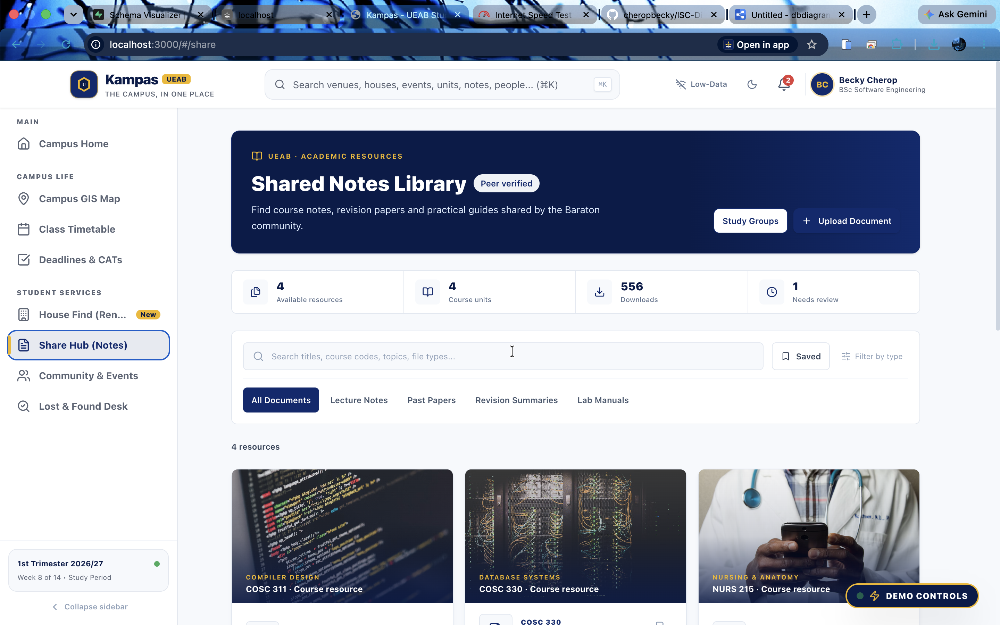
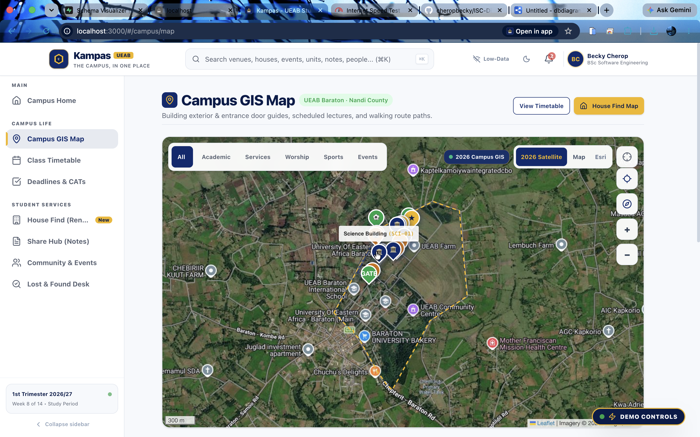
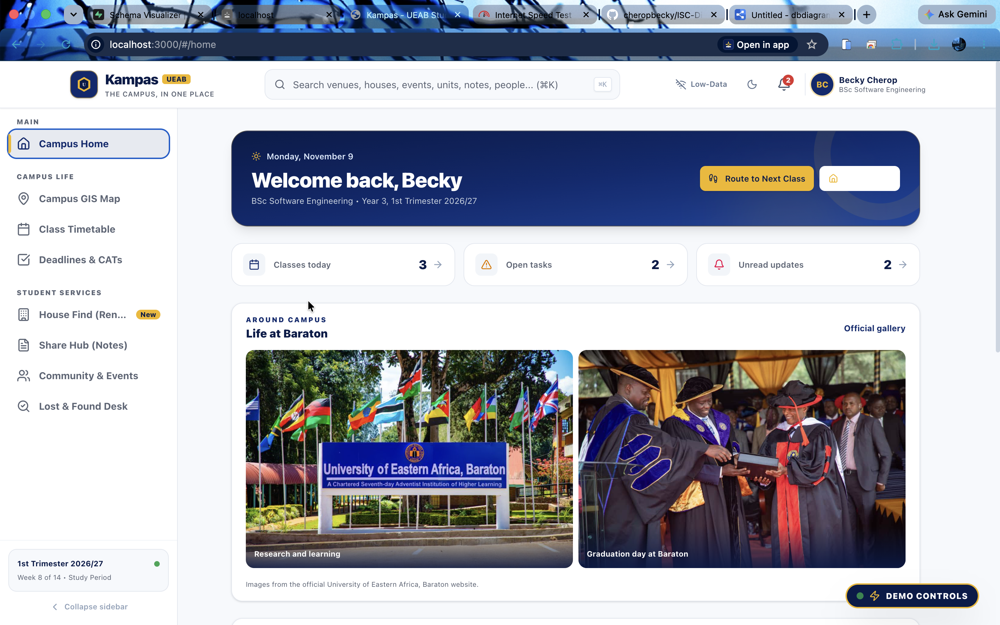
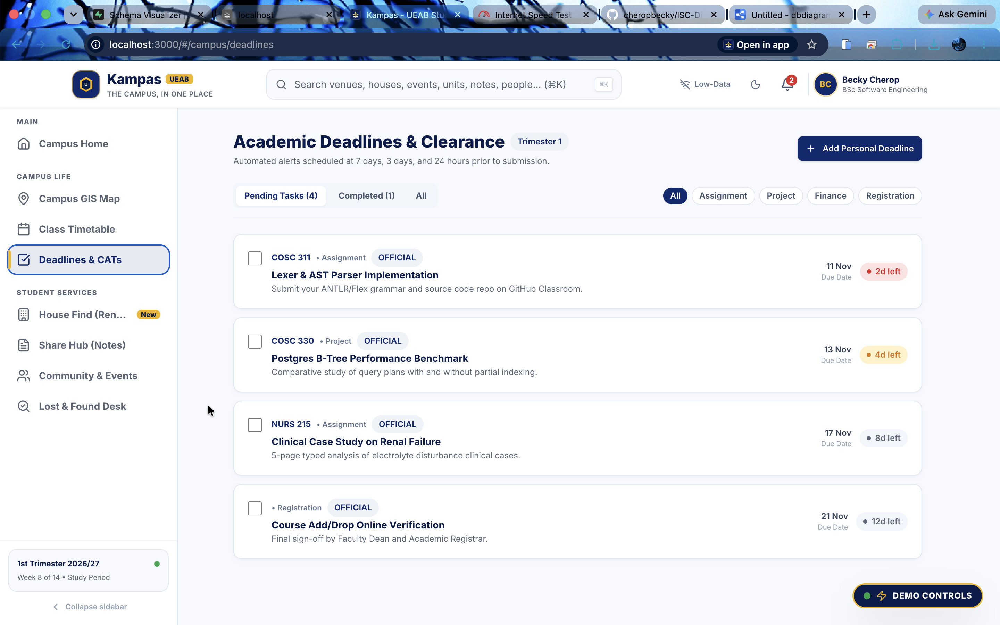
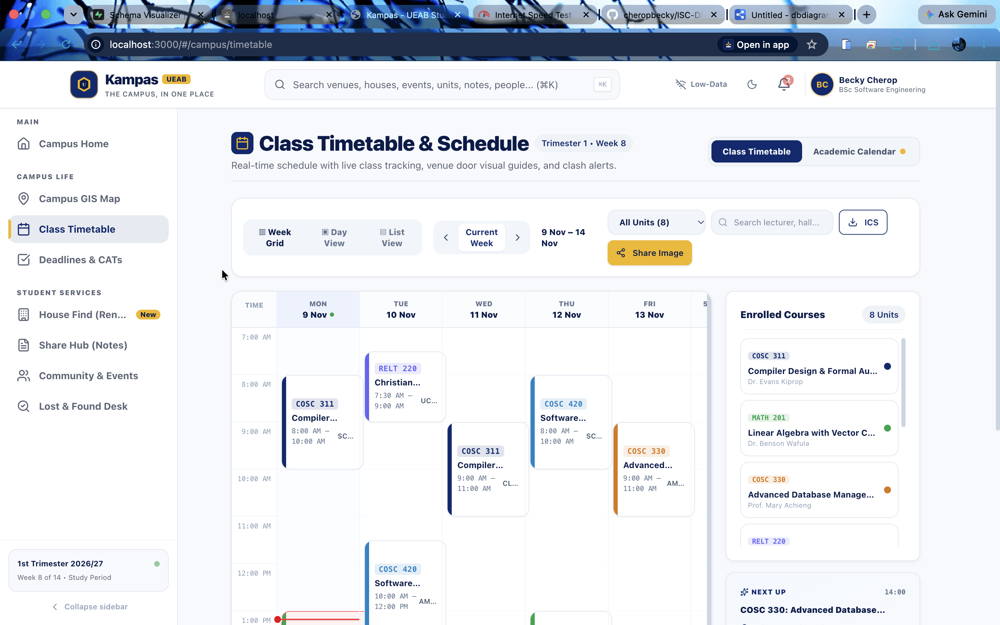
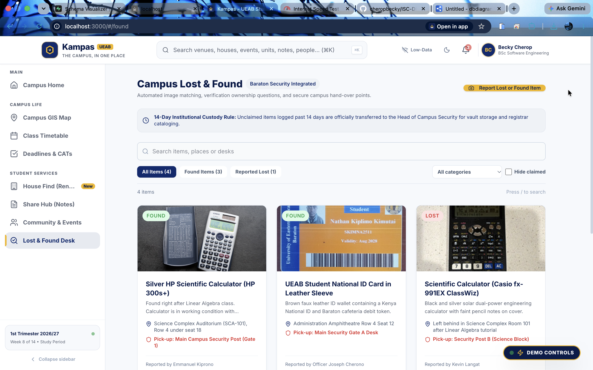
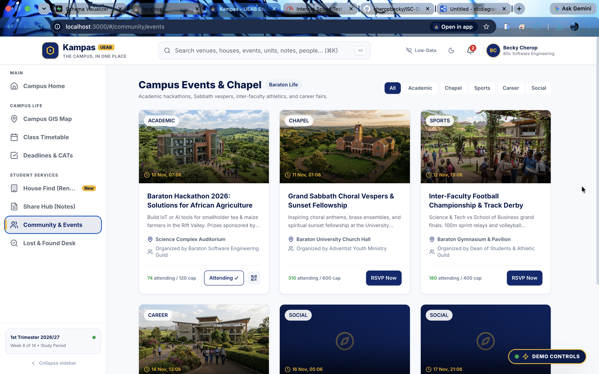
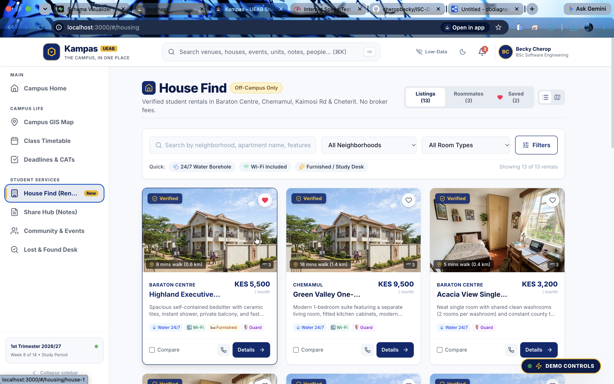
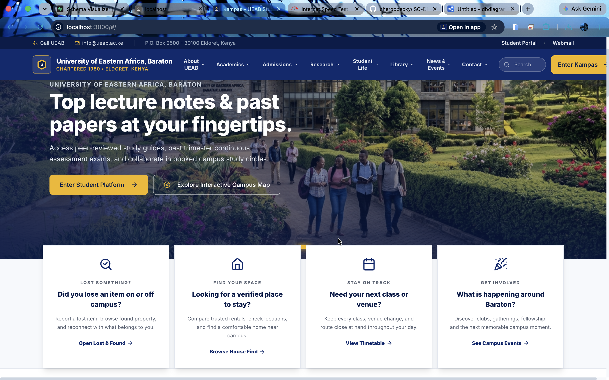

# Kampas — University of Eastern Africa, Baraton

> **The campus, in one place.**

Kampas is a responsive student platform and Progressive Web App for the
University of Eastern Africa, Baraton (UEAB), Nandi County, Kenya. It brings
campus navigation, timetables, housing, study resources, community activities,
and lost-and-found services into one student-focused interface.

## Features

### Campus Home

- At-a-glance dashboard for upcoming classes, deadlines, events, and housing.
- Interactive daily timetable overview.
- Official UEAB Baraton imagery and links to the university gallery.
- Responsive layout with dark mode, motion effects, and mobile navigation.

### Timetable and Calendar

- Weekly, daily, and list timetable views.
- Search and course filtering.
- Next-class and current-class indicators.
- Clash detection for overlapping classes.
- Venue relocation notices.
- Calendar events, deadlines, personal events, and ICS export.

### UEAB Baraton Campus Map

- Dedicated campus map centered on University of Eastern Africa, Baraton.
- Leaflet and OpenStreetMap tiles with required attribution.
- UEAB Baraton venue directory sourced from `src/data/venues.ts`.
- Searchable venue markers and venue detail cards.
- Venue photos loaded from official UEAB online image URLs.
- Walking directions through the public OSRM routing service.
- Browser geolocation with a permission-denied message.
- Marker clustering, touch controls, resize handling, and offline tile errors.

### Other Student Services

- Off-campus housing listings and comparison tools.
- Study notes, past papers, bookmarks, and study groups.
- Campus events, clubs, mentorship, and referrals.
- Lost-and-found item reporting and matching.
- Role-aware demo controls for testing interactive flows.

## Technology

- React 19
- TypeScript
- Vite
- React Router
- Tailwind CSS v4
- Motion
- Leaflet and React Leaflet
- Leaflet MarkerCluster
- OpenStreetMap
- OSRM routing
- Clerk authentication integration
- Supabase integration
- Zod validation
- Vite PWA

## Project Structure

```text
src/
├── app/                 # Application layout and routing
├── components/          # Shared UI and map components
├── data/                # UEAB venues, timetable, events, images, and mock data
├── features/            # Home, navigation, housing, sharing, community, and lost-found
├── lib/                 # Store, permissions, Supabase client, and utilities
└── services/            # Timetable, search, and application service layers
```

Important files:

- `src/features/core/HomePage.tsx` — Campus Home dashboard.
- `src/features/navigate/TimetablePage.tsx` — timetable and calendar interface.
- `src/features/navigate/CampusMapPage.tsx` — dedicated campus map page.
- `src/components/map/CampusMap.tsx` — Leaflet map, layers, markers, and routing.
- `src/data/venues.ts` — UEAB Baraton venue directory and coordinates.
- `src/data/images.ts` — central image URL registry and alt text.
- `src/services/timetableService.ts` — timetable data and timetable operations.

## Getting Started

### Requirements

- Node.js 18 or newer
- npm

### Install

```bash
npm install
```

### Configure environment variables

Copy the example file:

```bash
cp .env.example .env
```

The application can run in demo mode without Clerk or Supabase credentials.
For connected authentication and persistence, configure the variables described
in `.env.example`.

### Run the development server

```bash
npm run dev
```

Open `http://localhost:3000`.

### Validate and build

```bash
npm run lint
npm run build
```

To preview the production build:

```bash
npm run preview
```

## Map Data and External Services

The campus map uses:

- OpenStreetMap tiles:
  `https://{s}.tile.openstreetmap.org/{z}/{x}/{y}.png`
- OpenStreetMap attribution: `© OpenStreetMap contributors`
- OSRM walking routes:
  `https://router.project-osrm.org/route/v1/foot/`

The map requires no Google Maps API key, account, or billing. Venue coordinates
are maintained in `src/data/venues.ts` and are positioned around UEAB Baraton
in Nandi County, approximately `0.2589343, 35.0864822`.

Venue imagery is referenced as online URLs from the official UEAB website and
is registered centrally in `src/data/images.ts`. Images should include
descriptive alt text and must not be presented as facility-specific unless the
source identifies the facility.

## Environment Variables

Available variables are documented in `.env.example`:

| Variable | Required | Purpose |
| --- | --- | --- |
| `VITE_CLERK_PUBLISHABLE_KEY` | No | Clerk authentication in connected mode |
| `VITE_SUPABASE_URL` | No | Supabase project URL |
| `VITE_SUPABASE_ANON_KEY` | No | Supabase anonymous client key |
| `VITE_DEV_ROLE_SWITCHER` | No | Enables development role switching |
| `APP_URL` | No | Production URL and OAuth redirect base |

Do not commit real credentials or secret keys.

## Design and Accessibility

- UEAB-inspired blue and gold visual system.
- Responsive desktop, tablet, and mobile layouts.
- Touch targets sized for mobile interaction.
- Dark mode support.
- Descriptive image alt text.
- Keyboard-friendly controls where applicable.
- Graceful fallback states for unavailable images, tiles, and routes.

## Data and Demo Mode

When external services are not configured, Kampas uses local data and an
in-memory reactive store so the core application remains usable for
development and demonstrations. Personal calendar data is persisted locally in
the browser.

## Screenshots

The following screenshots show the current Kampas interface:

| Campus Home | Campus Map |
| --- | --- |
|  |  |

| Timetable | Academic Calendar |
| --- | --- |
|  |  |

| Housing | Share Hub |
| --- | --- |
|  |  |

| Community | Lost and Found |
| --- | --- |
|  |  |



## Team

| Name | Student ID | Assigned Project Role | Core Responsibilities & Contributions |
| --- | --- | --- | --- |
| Becky Cherop | SKIPCH2511 | Frontend Developer & UI Specialist | Designed responsive user interfaces and visual features with React, Tailwind CSS, and Vite, including campus maps and calendars. |
| Jacob Sihul | SSIHOT2511 | Backend & API Developer | Handled backend routing, authentication workflows, and API integrations. |
| Nathan Kimutai | SKIMNA2511 | Database Engineer | Architected the PostgreSQL/Supabase database schema, tables, and search indexing. |
| Thabita Jeptoo | STHAJE2511 | DevOps & QA Specialist | Managed GitHub branch workflows, deployments, quality assurance, and testing. |

## Current Project Details

- Institution: University of Eastern Africa, Baraton (UEAB)
- Location: Nandi County, Kenya
- Git branch used for current work: `Becky`
- Repository: `cheropbecky/KAMPAS`

## Credits and Licence

Third-party: React, Vite, Tailwind CSS, Lucide, Motion, Leaflet,
[OpenStreetMap](https://www.openstreetmap.org/copyright) © OpenStreetMap
contributors, OSRM, and Supabase.

AI-assisted tools were used and understood by the whole team, including
Google Stitch, Google AI Studio, and Claude.

All sample data is invented. Images are sourced from the official University
of Eastern Africa, Baraton website and credited in the application image
registry.

Licensed under the MIT Licence.